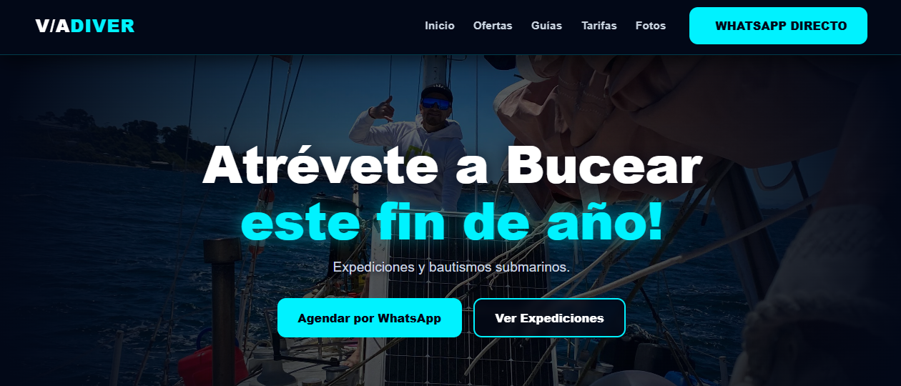
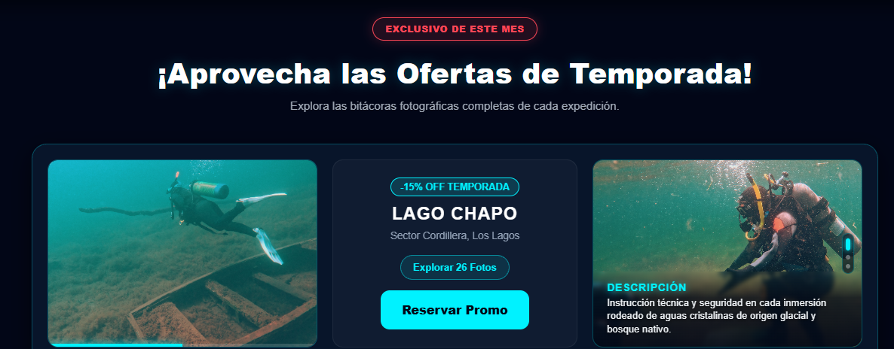
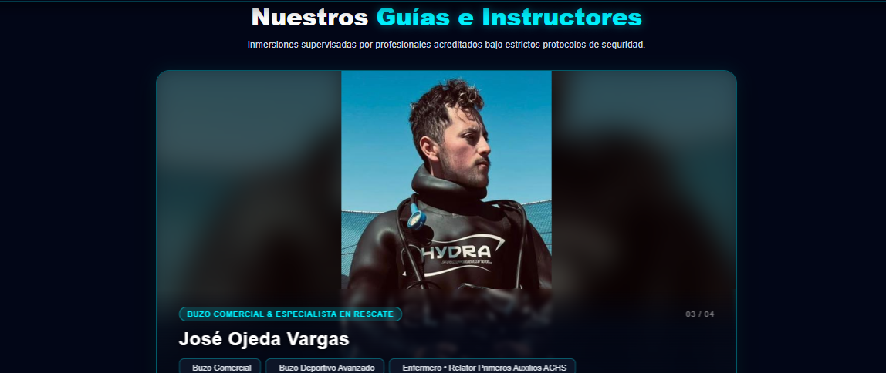
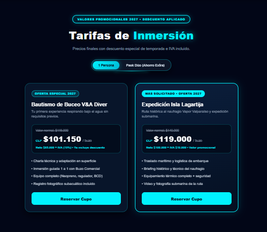
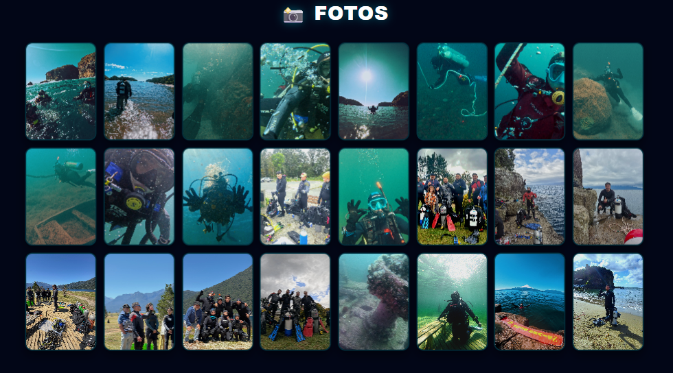

# 🤿 V/ADIVER — Landing Page & Plataforma de Expediciones Submarinas

Aplicación web comercial desarrollada a medida para **V/ADIVER** (Maullín, Región de Los Lagos, Chile). Diseñada con una arquitectura modular y estética inmersiva de alto contraste (**HUD / Estilo 2080**) optimizada para la conversión directa de reservas de bautismos submarinos y expediciones guiadas.

🌐 **Sitio en producción:** [diver.cl](https://diver.cl)

---

## 📸 Recorrido Visual por Secciones

### 1. Portada Inmersiva & Barra de Navegación Fija (`Hero` & `Navbar`)
> Interfaz principal con navegación *sticky* translúcida, menú hamburguesa responsivo con líneas neón CSS puras y llamado a la acción directo a WhatsApp.



---

### 2. Visor Dual de Expediciones & Bóveda Fotográfica (`Expediciones`)
> Tarjetas horizontales asincrónicas con efecto *Ken Burns*, telemetría visual por destino (*Lago Chapo, Los Riscos, Isla Lagartija, Lago Pellaifa y Piedra del Barco*) y visor *lightbox* de hasta 30 fotografías reales por expedición.



---

### 3. Staff Certificado & Guías Comerciales (`Bautismos`)
> Carrusel horizontal interactivo que presenta al equipo de buzos comerciales e instructores con encuadre adaptativo y credenciales oficiales verificadas (Armada de Chile, DAN, ACHS, Piloto R.O.V.).



---

### 4. Tarifario Dinámico con Selector de Modalidad (`Tarifas`)
> Comparador interactivo entre modalidad **Individual (1 Persona)** y **Pack Dúo (2 Personas)** con desglose transparente de valores Neto + IVA, precio anterior tachado y cotización prellenada al instante.



---

### 5. Galería Neón & Estación Geográfica (`Galeria` & `Footer`)
> Cuadrícula responsiva de 24 capturas subacuáticas con efecto *hover* neón y pie de página técnico equipado con radar satelital de coordenadas reales de Maullín.



---

## 🛠️ Stack Tecnológico

* **Core:** [React 18](https://react.dev) + [TypeScript](https://typescriptlang.org)
* **Entorno & Empaquetador:** [Vite](https://vitejs.dev)
* **Estilos:** [SASS / SCSS](https://sass-lang.com) modularizado por componente + CSS Grid / Flexbox
* **Tipografía & Iconos:** Google Fonts (*Orbitron* & *Inter*) + Font Awesome 6
* **Despliegue:** Hostinger (Static Production Build)

---

## 📂 Arquitectura del Proyecto

```text
diver.cl/
├── docs/                       # Capturas de pantalla para documentación
└── vadiver-frontend/
    ├── public/
    │   └── img/                # Activos visuales organizados por destino y staff
    │       ├── chapo/
    │       ├── guias/
    │       ├── lagartija/
    │       ├── maullin/
    │       ├── pellaifa/
    │       └── riscos/
    ├── src/
    │   ├── components/
    │   │   ├── Bautismos/      # Carrusel horizontal del equipo de guías
    │   │   ├── Expediciones/   # Visor dual 2080 y bóveda fotográfica por spot
    │   │   ├── Footer/         # Pie de página con radar táctico y contacto
    │   │   ├── Galeria/        # Cuadrícula general 8x3 y visor modal
    │   │   ├── Hero/           # Portada inmersiva principal
    │   │   ├── Navbar/         # Barra sticky con menú hamburguesa móvil
    │   │   ├── Tarifas/        # Tarjetas de precios con toggle Individual/Dúo
    │   │   └── BotonWhatsApp.tsx # Componente unificado de conversión a WhatsApp
    │   ├── App.tsx             # Ensamblaje principal de la landing page
    │   ├── config.ts           # Fuente única de datos (spots, staff, tarifas)
    │   └── index.css           # Variables globales y reseteo base
    ├── package.json
    └── tsconfig.json
```

---

## 🚀 Instalación y Despliegue Local

1. **Clonar el repositorio:**
   ```bash
   git clone https://github.com
   cd diver.cl/vadiver-frontend
   ```

2. **Instalar dependencias:**
   ```bash
   npm install
   ```

3. **Levantar servidor de desarrollo:**
   ```bash
   npm run dev
   ```
   Disponible en `http://localhost:5173/`.

4. **Compilar para producción (Hostinger):**
   ```bash
   npm run build
   ```
   Genera la carpeta optimizada `dist/` lista para subir al directorio `public_html` del servidor.

---

## 👨‍💻 Autoría

Desarrollado a medida para **V/ADIVER Chile**. Todos los derechos reservados sobre el código fuente, identidad visual y material fotográfico.
